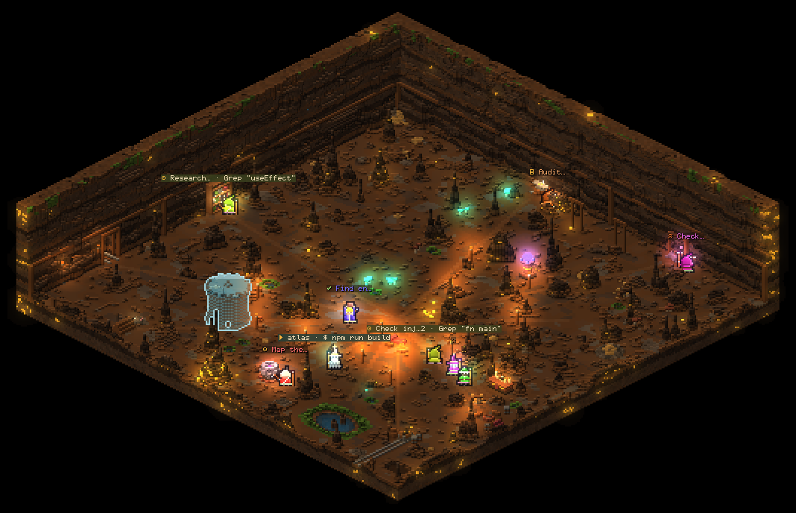

# animus

Your Claude Code agents, as tiny pixel people living and working in a
simulated isometric world in your terminal.

Every running Claude Code session and every subagent it spawns gets its own
procedurally generated character, dressed for the world it is in: wizards in
the caves, lab coats in the lab, party outfits in the club, hoodies in the
den, space suits on the station, everyday clothes in the café. What a
character does follows what its agent is doing right now (hammering, reading,
digging, stirring, casting, pondering), and in between they live: they
wander, sit, sip a drink, dance, chat, pet the resident critter, flinch at
explosions, cheer when someone finishes, and build things together.


## A world where every pixel is simulated

The scene is a cutaway room seen in 2:1 isometric, one voxel per pixel, and
every voxel is a material that moves: sand and gravel fall and pile, water,
oil and coffee flow and layer, fire spreads to anything that burns and
leaves ash and smoke, gas rises and fades, lava meeting water turns to
obsidian and steam, acid eats rock. Glowing things (fire, lava, neon,
screens, crystals, every character's light) light the room around them.

The agents' work is physical:

- **writing** strikes sparks at the workbench or anvil
- **searching** digs a tunnel into the wall
- **running** lights a fire under the cauldron or spins up the machine
- **errors** blow a small crater in the floor; it smokes, and a red ring
  and the error stay on show for a few seconds even after the next call
- **finishing** sets off fireworks that rain down as gold dust in the caves
  (indoors: confetti, paper, foam or sparks that vanish where they land),
  and the finished agent carries a block to the build site before leaving
- **delegating** casts a bolt at the subagent, who waves back

The work stations stand out on the floor around the middle of the room as
well as along the walls, so the crew works where you look. Idle and
finished agents fetch blocks and build a structure on the room's plazas: a
hologram of the goal (a tower, a house, a pyramid, a statue or a machine,
depending on the world) appears first and fills in block by block, and the
crew cheers every quarter. Over minutes the world heals (craters regrow,
debris erodes, springs refill), so a long session never wrecks it.

## Run it

Requires Node ≥ 23.6 (runs TypeScript directly, no build, no dependencies)
and a truecolor terminal.

```sh
node bin/animus.js            # live: watch the Claude Code agents on this machine
node bin/animus.js --demo     # a simulated crew, no Claude data needed
node bin/animus.js -t club    # pick a world

# optional: put it on your PATH
ln -s "$PWD/bin/animus.js" ~/.local/bin/animus
```

Run it from a clone (or a symlink to one). Installing it as a package under
`node_modules` won't work: Node refuses to strip TypeScript types there.

Start Claude Code in another terminal (or several) and they walk in.

### Resolution

animus picks the sharpest mode your terminal can show (`r` cycles, or pass
`--pixels`):

| mode | where | pixels per cell |
| --- | --- | --- |
| `hd` | kitty, Ghostty, WezTerm (kitty graphics protocol) | the cell's real pixels, as a true-colour image |
| `sextant` | Alacritty, foot, and the above | 2 x 3, two colours per cell |
| `half` | any truecolor terminal | 1 x 2 |

HD draws the whole room as an image under the text: voxels blown up 2-4x
to whole pixels with crisp outlines on every edge, and name tags in a small
pixel font a few pixels over each head. Only what changed goes out: the
characters at once, the room's slow animation a few times a second, and on
kitty just the changed tiles. In the text modes, a smaller terminal font (Ctrl+- in
most terminals) means more cells and so more pixels, and `f` gives the
whole terminal to the scene; animus mentions once that HD exists if your
terminal cannot show images.



Rooms are big (up to 256 x 256 voxels) and start zoomed out to fit; `tab`
selects an agent and zooms in on it (2x in HD), `+` / `-` step the zoom,
`z` hands it back.

## Worlds

| id | world | vibe |
| --- | --- | --- |
| `mines` | The Mines | timbered shafts, coal seams, gold, torches, a camp |
| `lab` | Mad Science Lab | a stormy tower lab, tesla coil, specimen tanks, a rat |
| `club` | Underground Club | neon on brick, a beat-driven dance floor, a DJ riser, sweeping beams |
| `den` | Hacker's Den | matrix rain, CRT rigs, server racks, an arcade lounge |
| `station` | Orbital Station | stars and a planet outside, a command island, a reactor, hydroponics |
| `cafe` | Cozy Café | rain on the windows, an espresso bar, a hearth, a cat |
| `fungal` | Fungal Caverns | giant glowing mushrooms, drifting spores, toxic sludge, lanterns |
| `snowy` | Snowy Depths | icy rock, falling snow, a frozen lake, braziers |
| `vault` | The Vault | a deposit hall in steel and amber, counting tables, a gold cage, acid in the pit |
| `hell` | Hell | a lava lake and lava fall, bone fields, flame vents, rising embers |

`node bin/animus.js --list-themes` prints them. The last world you picked
is remembered in `~/.config/animus/config.json`.

| | |
| --- | --- |
|  |  |
|  |  |
|  |  |
|  |  |
|  | |

## Keys

| key | action |
| --- | --- |
| `t` / `T` | next / previous world |
| `1`–`9`, `0` | jump to a world |
| `p` | world picker with live preview |
| `tab` / `shift-tab`, `←` `→` | select an agent (zooms in and follows it) |
| `+` / `-`, `z` | zoom in / out, automatic zoom |
| `f` | fullscreen scene (hide the panels) |
| `esc` | clear selection / close overlay |
| `d` | toggle the demo crew (mixes with live agents) |
| `r` | pixels: half blocks / sextants / HD (remembered) |
| `l` | lighting on / off (remembered) |
| `space` | pause |
| `?` | help |
| `q`, `ctrl-c` | quit |

## What the characters do

| activity | triggered by | in the world |
| --- | --- | --- |
| write | `Edit`, `Write`, `MultiEdit`, `NotebookEdit` | hammering or typing at the workbench, sparks |
| read | `Read` | reading a book at the shelf, pages turning |
| search | `Grep`, `Glob`, `LS`, `ToolSearch` | digging into the rock face or scanning |
| run | `Bash` and other tools | stirring the cauldron, running the machine |
| web | `WebFetch`, `WebSearch`, MCP tools | casting at the orb, on the phone |
| delegate | `Agent`/`Task`, `Skill`, `SendMessage` | casting a bolt at the subagent |
| think | thinking, planning, generating | hand to chin, a thought puff |
| talk | replying, asking you a question | gesturing |
| done | subagent finished | cheering, fireworks, a block for the build, then leaves |
| idle | session waiting for you | wandering, sitting, chatting, building; after a while a nap with z's, getting up now and then |
| error | a tool call failed | a small explosion, smoke, a red ring, `!`, staggering |

Leads (sessions) wear a crown. Subagents get accessories from their type:
reviewers wear glasses, explorers a miner's lamp, planners/architects a
beret, testers goggles, security agents a deep hood.

## How it connects to your Claude account

Animus never talks to the network. It reads, read-only, what Claude Code
already keeps on disk:

- `~/.claude/sessions/<pid>.json` — which sessions are running and whether
  they are busy, idle or waiting on you (dead pids are ignored)
- `~/.claude/projects/<project>/<session>.jsonl` — the session transcript,
  tailed incrementally (only new bytes are read)
- `~/.claude/projects/<project>/<session>/subagents/agent-*.jsonl` and
  `.meta.json` — subagents and their type/description
- `~/.claude.json` — only your display name (or the first word of your full
  name) and plan label for the header; tokens and other account fields are
  never read out

Text taken from transcripts (commands, file names, replies) is sanitized
before it is drawn: control characters and escape sequences are dropped and
wide glyphs replaced, so nothing in a transcript can drive your terminal.

Use `--claude-dir` (or `CLAUDE_CONFIG_DIR`) to point at another config dir.

## Other options

```
animus --snapshot [--demo] [--theme id] [--width 120] [--height 36] [--at 12]
    render one frame as ANSI text to stdout (good for previews and CI)
animus --fps <n>      frame rate (default 18)
animus --pixels <m>   auto (default), half, sextant or hd
animus --help | --version
```

## Development

```sh
node --test "test/**/*.test.ts"                                   # all tests
node scripts/preview-theme.ts hell --out /tmp/hell.png            # render a world to PNG
ANIMUS_THEME_FILE=src/cave/biomes/x.ts node --test test/themes.test.ts   # check a new biome
```

Layout: `src/claude` (read-only connector), `src/demo` (simulated crew),
`src/cave` (materials, voxel world, falling-sand simulation and particles,
isometric ray caster, lighting, wizard sprites, cave layout and props,
`biomes/`), `src/world` (traits, stage, world composition), `src/iso`
(pixel canvas, half-block and sextant blitting, PNG), `src/ui` (header,
roster, ticker, overlays), `src/term` (cell screen, diffing ANSI renderer,
terminal handling).

### Adding a biome

Create `src/cave/biomes/<id>.ts` exporting a `Biome` (see
`src/cave/types.ts`, and `src/cave/biomes/mines.ts` as the reference): UI
palette, light grade, material colour overrides, a `generate(v, layout, rng)`
that fills the voxel world (rock slabs, strata, floor, pools, decor) and
builds the eight props, the props themselves (usually `makeProps` from
`src/cave/props.ts` with your own materials, wrapped where a biome needs a
twist), and optionally `weather` for ambient life (drips, snow, spores, lava
falls), a `sky` for the void around the room, a `finale` for what a finish
showers down, a `costume` and what the crew `build`s. Keep liquids in basins and flames away from anything flammable: the
simulation will happily burn your cave down. Check it with
`ANIMUS_THEME_FILE=src/cave/biomes/<id>.ts node --test test/themes.test.ts`
and the PNG preview, then register it in `src/cave/biomes/index.ts`.
