# animus

[](https://github.com/eligof/animus/actions/workflows/ci.yml)
[](https://github.com/eligof/animus/actions/workflows/codeql.yml)
[](https://scorecard.dev/viewer/?uri=github.com/eligof/animus)
[](LICENSE)

Your Claude Code agents as cartoon characters, living and working in an
illustrated room in your terminal.

Every running Claude Code session, and every subagent it starts, walks in
as a character of its own, dressed for the world it is in, and a
workstation of its own pops up for it beside its teammates'. Its screen
follows what its agent is doing right now: code while it edits, an open
page while it reads, a terminal while it runs commands. In between they
live a little:
they wander, sit, chat, pet the resident critter, build things together,
huddle, fetch coffee, high-five and hold stand-ups, and nap. Select one to
see its card (context, energy, health, mood), open a chat to read its
conversation and send it a message, and watch your crew level up over
weeks of real work.

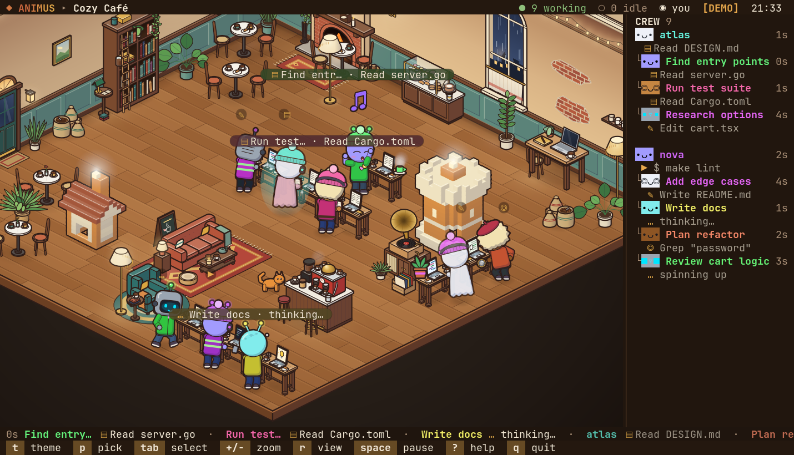

The room is drawn by animus's own rasterizer and shown as images in kitty,
Ghostty and WezTerm; any other terminal gets a text dashboard of the same
agents. No runtime dependencies, no network.

## Run it

Requires Node ≥ 23.6 (it runs the TypeScript directly: no build step, no
dependencies).

```sh
git clone https://github.com/eligof/animus.git && cd animus

node bin/animus.js            # live: the Claude Code agents on this machine
node bin/animus.js --demo     # a simulated crew, no Claude data needed
node bin/animus.js -t cafe    # pick a world

# optional: put it on your PATH
ln -s "$PWD/bin/animus.js" ~/.local/bin/animus
```

`npm start` and `npm run demo` do the same as the first two. Run it from a
clone (or a symlink to one). Installing it as a package under
`node_modules` won't work: Node refuses to strip TypeScript types there.

Start Claude Code in another terminal (or several) and they walk in. The
terminal needs to be at least 60 x 20; from 110 columns a crew roster shows
on the right.

## Views

| view | where | what you get |
| --- | --- | --- |
| scene | kitty, Ghostty, WezTerm (kitty graphics protocol) | the illustrated room, as images under the terminal's text |
| dashboard | any terminal | a text card per agent |

`--view auto` (the default) shows the scene when it recognises one of those
terminals (from `TERM`, `TERM_PROGRAM` or the terminal's own environment
variables), else the dashboard. Inside tmux or screen that is a guess: pass
`--view scene` or `--view dashboard` to choose. `r` switches between the two
and is remembered; a remembered scene is ignored in a terminal that cannot
show it.

The scene is outlined cartoon art in 2:1 isometric, drawn at your
terminal's cell size in pixels. The room is sized from the terminal's
columns and rows, not its pixels, so a HiDPI screen shows the same room,
only sharper, and on a very large terminal it stops growing instead of
turning big and empty. The furniture between the stations stands along the
back walls, in the corners and beside the stations, never loose at the
front of the room; the open floor in between is kept for workstations.
Names, speech bubbles, the card and the
chat are terminal text over the picture, so they stay crisp at any zoom.
The picture goes out as a stack of sprites: each is sent once and the
terminal keeps it, so a frame only moves what changed. It runs at 30 frames
a second by default (`--fps`). The room is fitted to the window; selecting
an agent zooms in on it and follows it, `+` / `-` step the zoom and `z`
hands it back. `l` turns the lamp light and glows off and on.

## Worlds

| | |
| --- | --- |
| 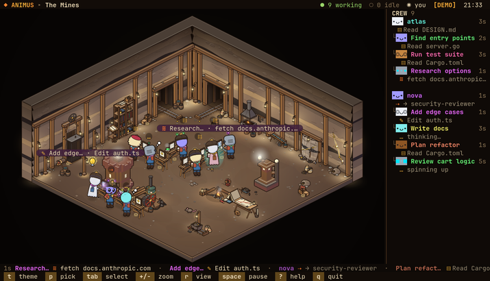<br>**The Mines** `mines`<br>Timbered shafts, coal seams and the glint of gold | 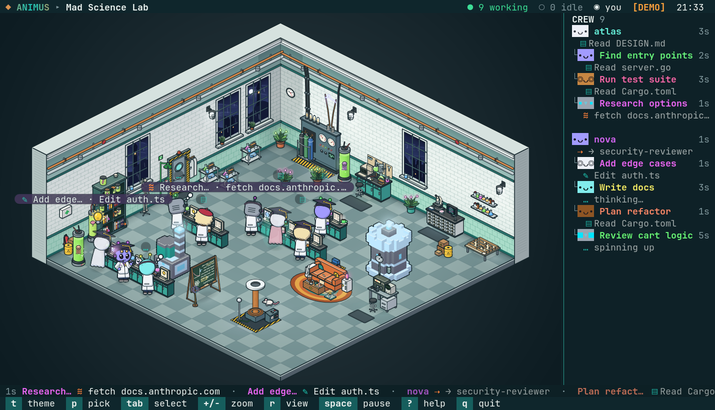<br>**Mad Science Lab** `lab`<br>Bubbling flasks, a tesla coil and a very busy chalkboard |
| 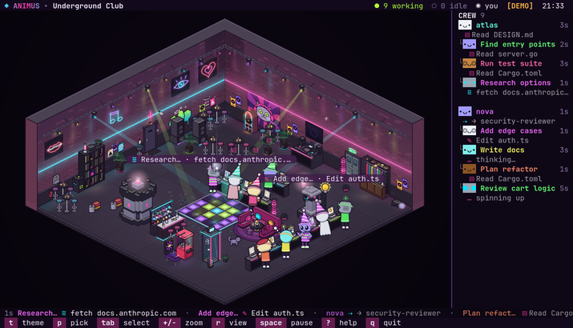<br>**Underground Club** `club`<br>Neon on brick, a floor that lights up and 128 BPM till dawn | 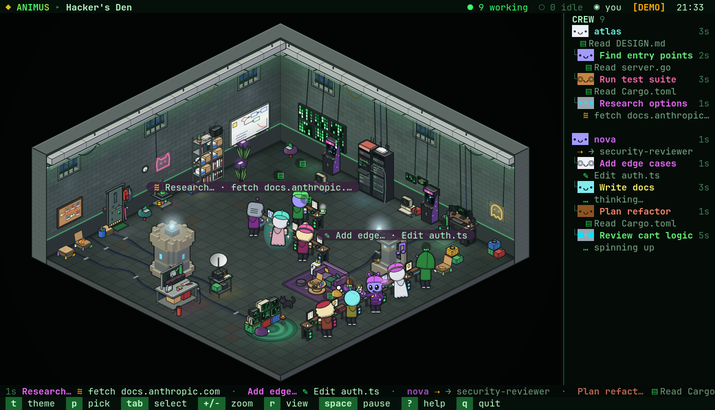<br>**Hacker's Den** `den`<br>Green rain on the walls, servers humming, pizza going cold |
| 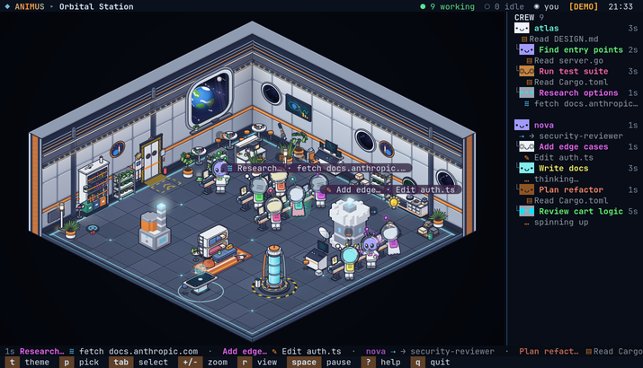<br>**Orbital Station** `station`<br>A cosy deck in orbit, a planet turning past the glass | 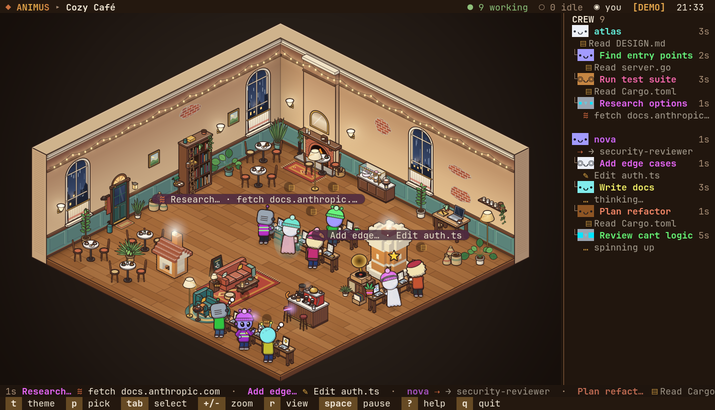<br>**Cozy Café** `cafe`<br>Rain on the windows, espresso and a cat by the fire |
| 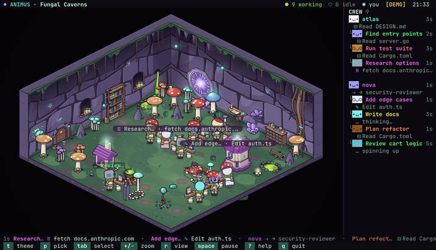<br>**Fungal Caverns** `fungal`<br>Giant mushrooms, glowing spores and a pit of toxic sludge | 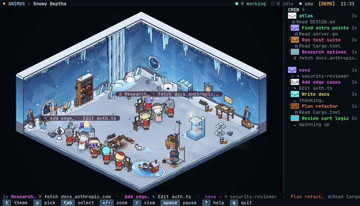<br>**Snowy Depths** `snowy`<br>Frozen falls, drifted snow and a pond iced over |
| 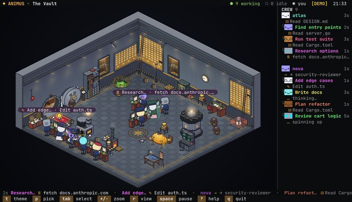<br>**The Vault** `vault`<br>Deposit boxes, gold under amber lamps and acid in the pit | 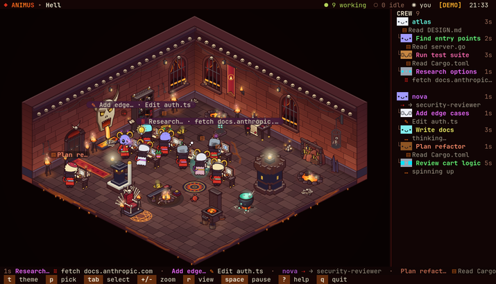<br>**Hell** `hell`<br>Lava lakes, brimstone and the bones of the damned |
| 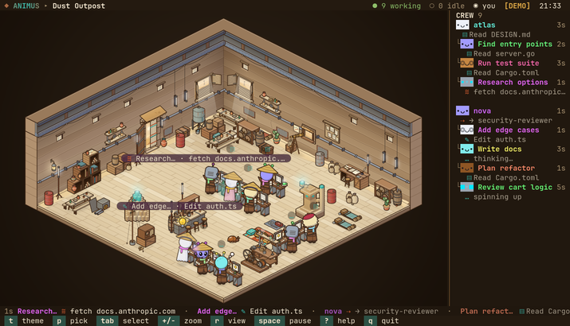<br>**Dust Outpost** `dunes`<br>Scrap walls, hide awnings and sand on the wind | 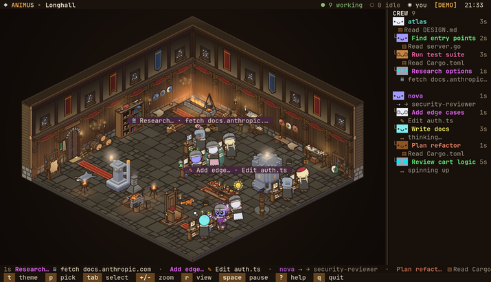<br>**Longhall** `meadhall`<br>Firelight on carved timber, snow at the high windows, mead on the long table |
| 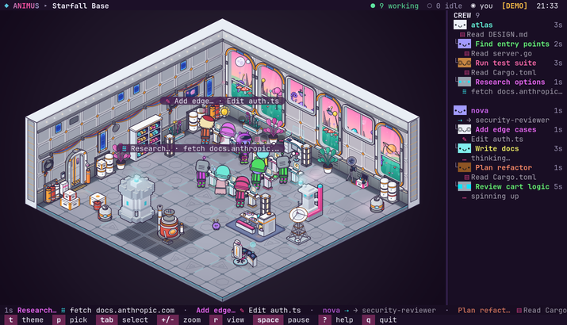<br>**Starfall Base** `starfall`<br>Two moons over a pink sky, strange flora past the glass | 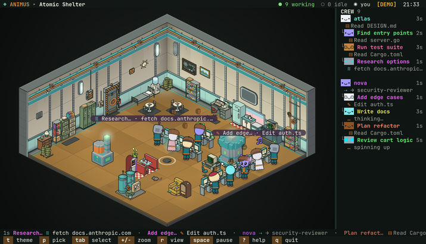<br>**Atomic Shelter** `shelter`<br>Riveted steel and a jukebox, deep under the wasteland |
| 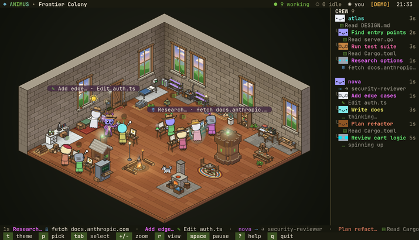<br>**Frontier Colony** `colony`<br>Stone and planks under a big sky, a campfire and a husky | 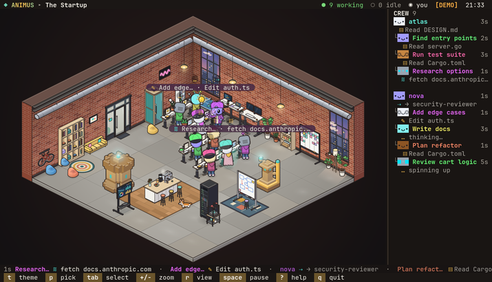<br>**The Startup** `office`<br>Exposed brick, standing desks and an espresso machine that never sleeps |

`node bin/animus.js --list-themes` prints them. `t` / `T` step through the
worlds, `1`–`9` and `0` jump to one of the first ten, `p` opens a picker
with a live preview. The last world you picked is remembered.

## The agent card

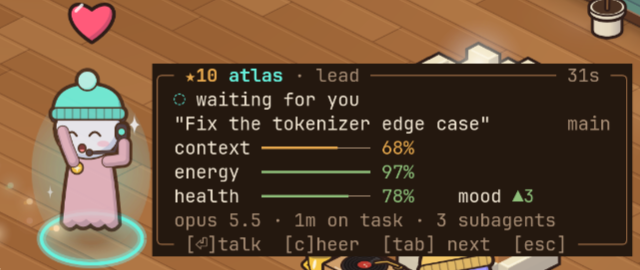

`tab` selects an agent and opens its card beside its character (it moves to
the other side near an edge, and docks in a corner when there is no room).
`i` hides and shows the card, `c` cheers the agent on (it throws its arms
up, a heart over it; nothing is sent anywhere), `esc` clears the selection.

The card shows the agent's level in its crew (`★N`), name, role and how long
it has been at its current activity; what it is doing; the session's title
and git branch; four meters; and its model, time on task and live
subagents. The meters come from its transcript:

| meter | means | from |
| --- | --- | --- |
| context | how full its context window is | the latest reply's input and cache tokens over the model's window (200k, or 1M for a `[1m]` model or once past 200k) |
| energy | how long it has worked without a break | drains over 45 minutes of work with no 2-minute pause; full again after 2 minutes idle |
| health | recent failures | each failed tool call or API error costs a quarter, healing over 10 minutes; calls refused by a hook, by the permission rules or by you, and interrupts, do not count |
| mood | how well it is going | the run of tool calls since its last failure (the number after `▲` or `▼`), lifted for a while when a turn finishes |

Bars are green, amber or red by level, and pulse when critical (context
at 90 %, energy at 15 %, health at 30 %). The character shows them too:
drowsy eyes when its energy is critical, a bandage when its health is, a
grin and a bigger bounce when its mood is high.

The card is part of the scene; in the dashboard each agent has a card of
its own (see below).

## Talking to an agent

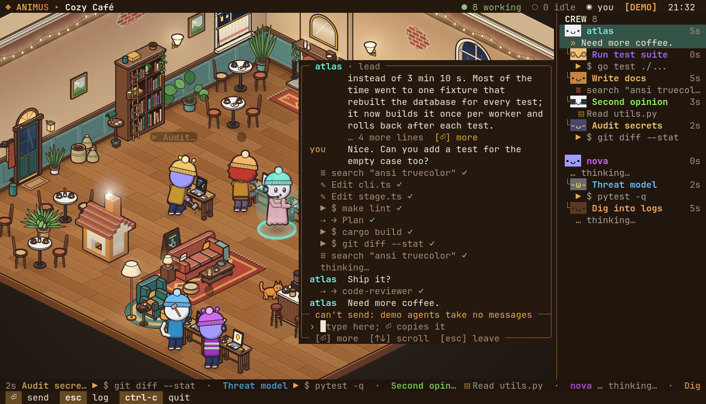

`enter` on a selected agent grows its card into a chat window. It shows the
conversation from its transcript, newest at the bottom: its replies, the
prompts it was given (yours, or the task a lead gave a subagent), its tool
steps as one-line rows with ✓ or ✗, a mark where it thought (never what),
and the messages you sent from animus. Long messages fold; `enter` on an
empty line opens the one marked `[⏎] more`.

Type at the bottom and press `enter` to send the text to that live session.
animus uses Claude Code's
[cross-session messaging](https://code.claude.com/docs/en/cross-session-messaging):
it looks the session up in `~/.claude/sessions/<pid>.json`, takes the local
Unix socket listed there, and writes your text to it as a message from
"animus". Each message you send shows how it went: `sending…`,
`sent, waiting`, `✓ delivered` once the session's transcript shows it,
`not seen` after a minute without (held for approval, or dropped), or
`✗ not sent` with the reason (the text goes back into the input to try
again).

What leaves animus, and where:

- Only text you type and send. Nothing from a transcript, no file, no
  token.
- Only to the session you picked, and only through a socket owned by you:
  before sending, animus checks that the registry entry is your own file
  for a running process, and that the socket is a real Unix socket (not a
  link) that only you can open, in a directory others cannot change. It
  never reads the `<pid>.key` files or any token.
- Never over the network.

The receiving session must take cross-session messages: a Claude Code with
messaging (v2.1.224 or later on macOS and Linux; sessions started in bare
mode have no socket). Its `crossSessionInbound` setting decides: `accept`
delivers, `hold` holds the message, `refuse` drops it. With no setting, a
session that prompts for permissions takes the message, and a session in
bypass-permissions mode holds it for your approval in its own terminal.
Claude sees it as a message from another session, not as your input: it
cannot approve a permission prompt, and a slash command in it does not run.

Subagents run inside their lead's session and have no socket of their own;
demo agents have none either. For them, and for a session that takes no
messages, the window says why, and `enter` copies your text to the
clipboard instead (OSC 52, if your terminal allows it), to paste where you
like.

While the input has focus every key types (`q` types q):

| key | in the input |
| --- | --- |
| `enter` | send (or copy, see above); on an empty line, open the folded message |
| `esc` | leave the input for the log |
| `↑` `↓`, `pgup` `pgdn` | scroll |
| `←` `→`, `home` `end`, `ctrl-a` `ctrl-e` | move the cursor |
| `alt-b` / `alt-f` | a word left / right |
| `backspace`, `delete` | delete a character |
| `alt-backspace`, `ctrl-u` | delete the word before the cursor, everything before it |
| paste | types the text, line breaks as spaces, so a pasted block is one message |
| `ctrl-c` | quit |

In the log, `enter` goes back to the input, `home` / `end` jump to the
oldest / newest, `esc` closes the window, and the other keys work as usual.
A draft stays with its agent while the window is closed.

## Growth

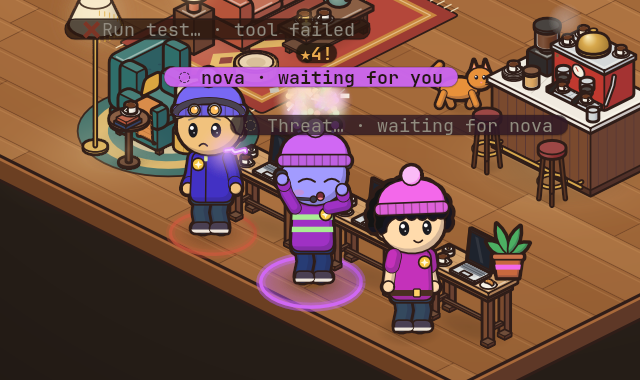

Each project has a crew that grows with real work. A project is the top of
a git checkout (a linked worktree counts as its main checkout, so worktrees
share a crew), or the working directory outside git. Within a crew, agents
are kept by role, not by session: the lead, and each subagent type
(`Explore`, `code-reviewer`, …).

| XP | for | goes to |
| --- | --- | --- |
| +10 | a finished turn (its reply ends the turn; once per prompt) | the lead |
| +5 | a build or test command that passes (`npm test`, `pytest`, `cargo build`, `go test`, `make`, `tsc`, …), not run in the background | whoever ran it |
| +3 | a subagent that finishes its run well (not failed, not interrupted) | its type |

Failures cost nothing. Levels come at 100, 250, 500 and 1,000 XP, then at
each doubling. A level-up showers the world's confetti, `★N!` rises over
the character and it cheers. Levels unlock cosmetics, in each world's
style:

| level | XP | unlocks |
| --- | --- | --- |
| ★2 | 100 | a hat: a leather cap with a lamp in the mines, a mortarboard in the lab, a party hat in the club, a cap worn backwards in the den, an antenna on the station, a beanie in the café, a toadstool cap in the caverns, a trapper hat in the snows, a peaked guard's cap in the vault, curled gold horns in hell, a wide straw cone at the outpost, an iron helm in the longhall, a helmet with its visor up at the base, a newsboy cap in the shelter, a cowboy hat in the colony, a snapback worn backwards at the startup |
| ★3 | 250 | a badge on the shirt |
| ★5 | 1,000 | a desk upgrade (a plant, a steaming mug or a trophy) on its own workstation |
| ★8 | 8,000 | its outfit in other colours |
| ★10 | 32,000 | a soft aura |

Work done while animus was closed counts too, as far as the end of each
running session's transcript that animus reads at the start still holds it
(the last 256 KB); quietly, without confetti. Nor is there any for a
level-up while animus is paused or too small to show the scene: the XP
counts, the show is missed. Nothing is counted twice: each role remembers
when it last earned.

Crews are kept in `~/.config/animus/crews.json` (under `$XDG_CONFIG_HOME`
when set), written for your user only (mode 0600) ten seconds after a
change and on the way out. For each project it holds a hash of its path,
and for each role its XP and when it last earned any: nothing from a
transcript. A file that is not a crews file is moved aside
(`crews.json.bad-<time>`) and a fresh one started. If `crews.json` is there
but cannot be read (no permission, a failing disk; a read that fails only
for a moment is tried again first), animus leaves it as it is and that
run's XP is not saved: the help (`?`) says so, and so does a line on stderr
when it quits. The demo crew (`--demo`, `d`) is a throwaway, some way along
already.

## Dashboard

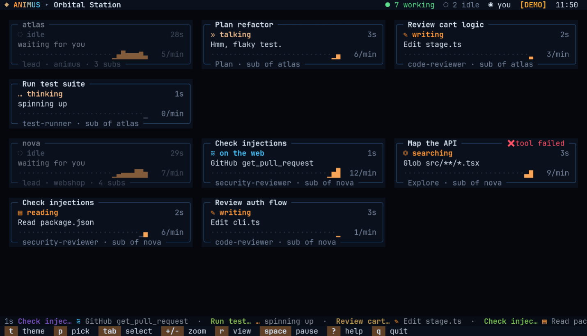

Without images, the scene's space holds a card per agent in a grid: what it
is doing and on which tool or file, a ten-minute sparkline of its activity
with calls per minute, its role, project and subagents, and a flag for a
recent error. `tab` walks the cards and `enter` opens the chat, docked. The
header, ticker and keys are the same as in the scene.

## What the characters do

Every agent works at a workstation of its own, drawn in its world's style:
a laptop table in the café, a lantern-lit workbench in the mines, a
scribe's desk in the longhall, a standing desk at the startup. It pops up
out of the floor as its agent walks in, a lead's first and its subagents'
round it in a pod, and goes a few seconds after its agent leaves. Its
screen shows what the agent is doing, the same in every world. When every
place is taken (a small terminal holds fewer), a newcomer shares a
teammate's workstation, standing at its side.

| activity | triggered by | on its screen |
| --- | --- | --- |
| write | `Edit`, `Write`, `MultiEdit`, `NotebookEdit` | lines of code |
| read | `Read`, MCP resource reads | an open page |
| search | `Grep`, `Glob`, `LS`, `ToolSearch` | a magnifier over a list |
| run | `Bash` and any other tool | a terminal with sparks |
| web | `WebFetch`, `WebSearch`, MCP tools | a globe |
| think | thinking, planning, a new task | a lightbulb |
| delegate | `Agent`/`Task`, `Skill`, `SendMessage`, `Workflow` | speech marks; it casts a bolt at its subagent, who waves back |
| talk | a reply, a question for you | speech marks, glints round it |
| error | a failed tool call | a bang: sparks, smoke and `!`; those near flinch; it stays on show for 5 seconds |
| done | a subagent finished | a high-five with its lead, then fireworks and the world's confetti, the crew cheers; it helps build, then leaves |
| idle | the session waits for you | wandering, sitting, chatting, petting the critter, building, a coffee, a stand-up with its crew; after a while a nap with z's |

The room's own props for each kind of work stay as its scenery, and idle
agents and office life still use the room round them. Idle and finished
agents fetch blocks and raise a build on the room's plazas: a hologram of the goal (a tower, house, pyramid, statue or machine,
by world) fills in block by block, and the crew cheers every quarter.

Each world dresses its crew for its setting: overalls in the mines, lab
coats in the lab, party clothes in the club, hoodies in the den, space
suits on the station, everyday clothes in the café, a forager's capelet in
the caverns, a parka in the snows, a guard's uniform in the vault, a
devil's robe in hell, a rawhide coat at the outpost, a fur mantle in the
longhall, an exosuit at the base, a teal jumpsuit in the shelter, a
duster in the colony and a zip hoodie, jeans and sneakers at the startup
(where the critter is the office corgi). Leads wear a headset. Subagents
dress by type: reviewers wear glasses, explorers a miner's lamp, planners
and architects a beret, testers goggles, security agents a hood (from ★2
the world's level hat takes the place of the lamp, beret or hood). Species
(human, robot, cat, alien, ghost), hair and colours come from the agent's
id, so an agent looks the same every time.

## Office life

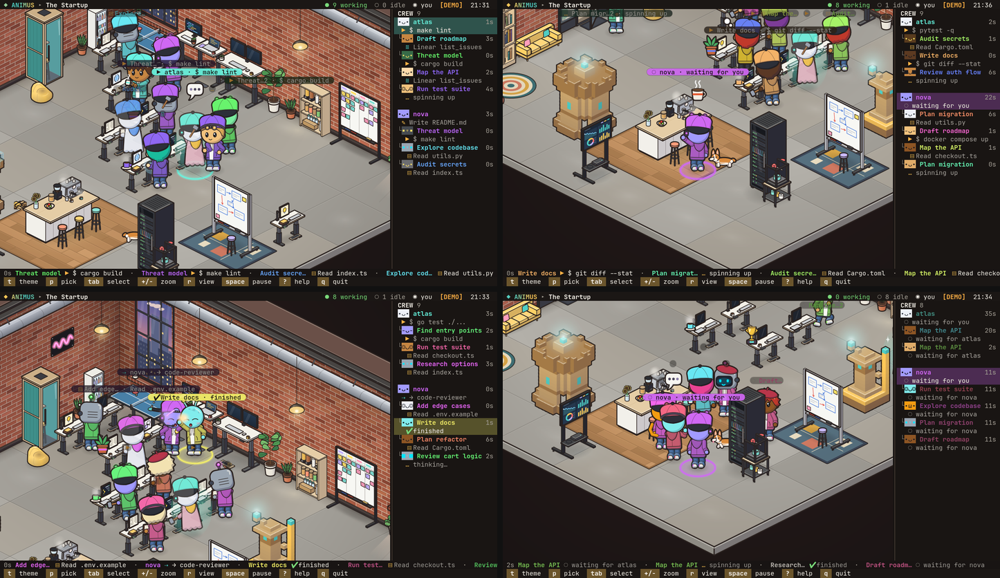

Between tasks the crew keeps a little office life, in every world:

- **Kick-off huddle.** When a lead starts subagents, the newcomers gather
  round it and nod along under its speech mark for a moment, then go to
  their stations (at most once a lead every 30 seconds).
- **Coffee run.** Now and then an idle agent walks to the world's drink
  spot (or, in a room without one, somewhere warm) and comes back with a
  mug, sipping from it for a while, at work too.
- **High-five.** A subagent that finishes walks over to its lead and they
  high-five (a lead at work turns and raises a hand at its desk); then
  comes its confetti.
- **Stand-up.** When three or more of a crew are idle, now and then they
  gather in a ring and take turns to talk.

It is all for show: nothing is sent or changed, a working agent never
leaves its workstation for it, and anyone given work drops it at once. `o`
turns office life off and on, for pure status, and is remembered.

## Keys

| key | action |
| --- | --- |
| `t` / `T` | next / previous world |
| `1`–`9`, `0` | jump to one of the first ten worlds (`0` is the tenth) |
| `p` | world picker with live preview (`↑` `↓` browse, `enter` keep, `esc` go back) |
| `tab` / `shift-tab`, `←` `→` | select the next / previous agent (the scene zooms in and follows it) |
| `i` | the selected agent's card on / off |
| `c` | cheer the selected agent |
| `enter` | talk to the selected agent (see [Talking to an agent](#talking-to-an-agent)) |
| `esc` | close an overlay, else clear the selection |
| `+` / `-`, `z` | zoom in / out, automatic zoom |
| `f` | fullscreen scene (hide the header, roster and footer) |
| `r` | scene / dashboard (remembered) |
| `l` | lighting on / off (remembered) |
| `o` | office life on / off (remembered) |
| `d` | demo crew on / off (mixes with live agents) |
| `space` | pause |
| `?` | help |
| `q`, `ctrl-c` | quit |

## How it connects to your Claude account

animus never talks to the network, and never reads a token. It reads what
Claude Code already keeps on disk:

- `~/.claude/sessions/<pid>.json`: which sessions are running, whether they
  are busy, idle or waiting on you, and (for the chat) their messaging
  socket. Entries of dead processes are ignored.
- `~/.claude/projects/<project>/<session>.jsonl`: the session transcript,
  tailed (the last 256 KB at first, then only new bytes).
- `~/.claude/projects/<project>/<session>/subagents/agent-*.jsonl` and
  `.meta.json`: subagents and their type and description.
- `~/.claude.json`: from its `oauthAccount`, only your display name (or the
  first word of your full name) and your plan label, for the header. Tokens
  and the other fields are never copied out.
- The `.git` entry of each session's working directory, to find its project
  for growth.

It writes only its own files: `~/.config/animus/config.json` (world, view,
lighting, office life) and `~/.config/animus/crews.json` (growth). The one
thing it ever sends is a chat message you type, to the session you picked,
through that session's local socket (see
[Talking to an agent](#talking-to-an-agent)).

Text from transcripts (commands, file names, replies) is made safe before
it is drawn: control characters and escape sequences are dropped and wide
glyphs replaced, so nothing in a transcript can drive your terminal.

`--claude-dir` (or `CLAUDE_CONFIG_DIR`) points it at another Claude config
dir.

## Other options

```
usage: animus [options]

  Watch your Claude Code agents live and work as cartoon characters in an
  illustrated room (kitty, Ghostty, WezTerm), or on an agent dashboard.

options:
  -t, --theme <id>      scene preset (see --list-themes)
      --demo            simulated crew instead of live Claude data
      --fps <n>         frames per second (default 30)
      --view <view>     auto, scene (an image: kitty, Ghostty, WezTerm) or
                        dashboard (text); default auto
      --claude-dir <p>  Claude config dir (default $CLAUDE_CONFIG_DIR or ~/.claude)
      --list-themes     list scene presets
      --snapshot        render one frame to stdout and exit
      --width <n>       snapshot width (default 120)
      --height <n>      snapshot height (default 36)
      --at <seconds>    snapshot simulation time (default 12)
  -h, --help            show this help
  -v, --version         show version
```

A snapshot is text: the dashboard, or with `--view scene` the scene's
labels and chrome without the picture.

## Development

```sh
node --test "test/**/*.test.ts"                # all tests

# typecheck (TypeScript is not a runtime dependency: devDependencies only,
# pinned by hash in package-lock.json, the same versions CI uses)
npm ci --ignore-scripts
npx tsc -p tsconfig.json

node scripts/scene-shot.ts cafe /tmp/cafe.png  # render a world with the demo crew to PNG
```

`scripts/scene-shot.ts <world> <out.png>` renders a world by its id, or by
its module file (`src/worlds/<id>.ts`) to look at one not registered yet.
It takes `--at <s>` (demo time, default 20), `--size 150x46` (terminal
cells), `--cell 10x20` (cell pixels), `--zoom <n>` (`+` presses),
`--select <n>` (the n-th agent picked, from 0), `--full` and `--dark`
(lighting off). It renders only the picture; labels, card and chat are
terminal text.
`scripts/sarif-gate.ts` fails CI on any CodeQL finding.

Layout:

- `src/cli.ts`, `src/app.ts`: options, the frame loop, terminal IO.
- `src/claude`: the connector: session registry, transcript tailing,
  activities, vitals, the chat log, XP gains, account, and `inbox.ts`
  (sending a message).
- `src/demo`: the simulated crew.
- `src/pet`: meters, crew XP, levels and unlocks, project roots, the crews
  file.
- `src/world`: `world.ts` (sources to stage to screen; keys), `stage.ts`
  (characters, camera, labels, effects, level-ups), `life.ts` (what they do
  between work), room planning, paths, builds, the critter, particles.
- `src/worlds/<id>.ts` and `src/worlds/<id>/`: one world each (room,
  stations, decor, its workstation); `types.ts` is the contract, `index.ts` the registry.
- `src/art`: the zero-dependency rasterizer (`canvas.ts`, a Canvas2D
  subset; `iso.ts`, shared isometric primitives; `png.ts`), `figure/` (the
  cartoon characters, critters, emotes and desk upgrades) and `scene.ts`
  with `scene/` (a frame as a stack of sprites).
- `src/term`: `kitty.ts` (the graphics protocol), `plates.ts` (the sprite
  compositor: sends each sprite once, then only placements that changed),
  the cell screen and diffing ANSI renderer, raw terminal input.
- `src/ui`: header, roster and footer, help and picker, the agent card, the
  chat window and its input, the dashboard.

### Adding a world

1. Create `src/worlds/<id>.ts` exporting a `WorldDef` (see
   `src/worlds/types.ts`; `src/worlds/cafe.ts` and `src/worlds/cafe/` are a
   good reference): a name and tagline, the UI palette, a backdrop, an ink
   colour, the `room` (floor and back walls, with an optional per-frame
   overlay), a prop for each station (`write`, `read`, `search`, `run`,
   `web`, `think`, `idle` and the `entrance`, each at the footprint
   `PROP_SIZE` in `src/world/layout.ts` gives it), optional decor and
   ambient tint, the `costume`, the `critter`, the `finale` colours, what
   the crew `build`s and, optionally, its `workstation` (a desk at the
   footprint `DESK` in `src/world/desks.ts` gives it, naming its `screen`
   and the `top` where a desk upgrade stands; without one it gets a plain
   desk in its colours).
2. Draw with the `Pen` (`src/art/types.ts`) and the helpers in
   `src/art/iso.ts`, following the art direction in
   `docs/superpowers/specs/2026-10-24-illustrated-design.md`: one ink colour,
   light from the upper left, no text in the picture.
3. Check it against the contract with
   `ANIMUS_THEME_FILE=src/worlds/<id>.ts node --test test/themes.test.ts`.
4. Register it in `WORLDS` in `src/worlds/index.ts` (the order is the
   picker's and the number keys'), add its id to the registry test in
   `test/themes.test.ts`, and look at it with
   `node scripts/scene-shot.ts <id> /tmp/<id>.png`.

## License

MIT, see [LICENSE](LICENSE).

## Security

To report a vulnerability, see [SECURITY.md](SECURITY.md).
